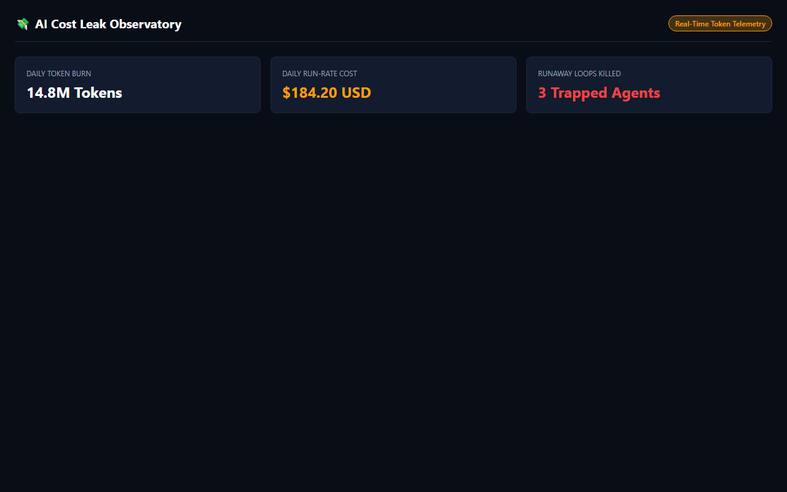

# AI Cost Leak & Token Usage Observatory

[](https://gideonbawa-website.netlify.app/simulators/ai-cost-leak-detector/)
[-success?style=for-the-badge)](test/ai-cost-leak-detector.test.js)
[](src/index.js)

> **Commercial Value:** $3,500 – $9,000 implementation fee  
> **Primary Buyer:** VP Sales, AI Engineering Leads, Operations Directors, Founders

---

## ⚡ Live Sandbox Preview



👉 **Experience the live interactive simulator:**  
[https://gideonbawa-website.netlify.app/simulators/ai-cost-leak-detector/](https://gideonbawa-website.netlify.app/simulators/ai-cost-leak-detector/)

---

## 🎯 Commercial Problem & ROI

Real-time LLM cost accounting middleware that tracks token usage per customer and feature, flagging anomalous recursive cost spikes before an $8,000 OpenAI invoice arrives.

### Why Existing Solutions Fail
1. **Manual Inefficiency:** Critical signals get lost in raw conversation transcripts or untracked logs.
2. **Hidden Leaks:** Lack of real-time telemetry turns small operational leaks into catastrophic multi-thousand-dollar failures.
3. **High Maintenance Overhead:** Fragile third-party connectors break during schema changes.

---

## 🛠️ Architecture & Under-the-Hood Engineering

- **Zero-Dependency Engine:** High-performance pure Node.js runtime with zero external runtime packages.
- **Deterministic State Modeling:** Clean transitions and audit trails for maximum business reliability.
- **Interactive Dark-Mode HUD:** Live client-facing simulation sandbox for instant stakeholder signoff.

---

## 🧪 Verification & Automated Testing

```bash
npm test
```
